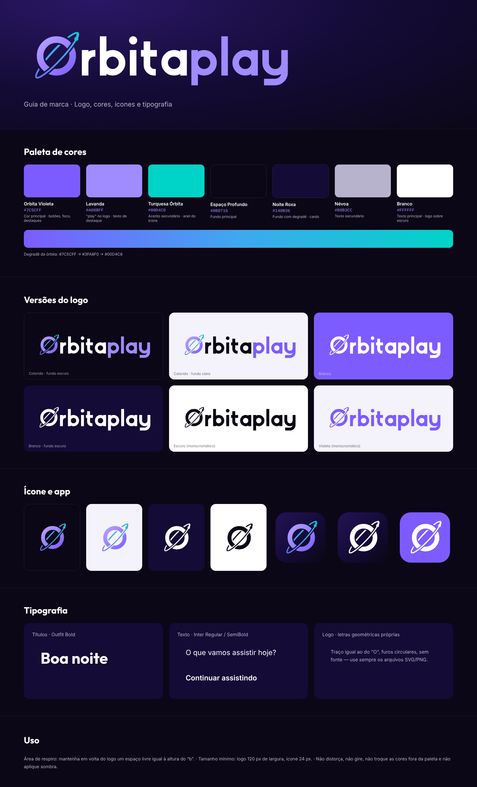

# OrbitaPlay — Kit de marca

## Cores

| Nome | Hex | Uso |
|---|---|---|
| Orbita Violeta | `#7C5CFF` | Cor principal: botões, foco e destaques |
| Lavanda | `#A08BFF` | "play" no logo, texto de destaque |
| Turquesa Órbita | `#00D4C8` | Acento secundário, anel do ícone |
| Espaço Profundo | `#0B0716` | Fundo principal |
| Noite Roxa | `#140B36` | Fundo com degradê, cards |
| Névoa | `#B8B3CC` | Texto secundário |
| Branco | `#FFFFFF` | Texto principal, logo sobre fundo escuro |

Degradê da órbita: `#7C5CFF → #3FA8F0 → #00D4C8`
Degradê do "O": `#B9A6FF → #7C5CFF`
Fundo do ícone do app: `#241356 → #140B36 → #0B0716`

## Arquivos

| Pasta | Conteúdo |
|---|---|
| `svg/logo/` | Logo completo (vetor) |
| `svg/icon/` | Só o símbolo Ø e ícones de app (vetor) |
| `png/logo/` | Logo em PNG transparente: 512, 1024 e 2048 px de largura |
| `png/icon/` | Símbolo e ícones de app: 128, 256, 512 e 1024 px |
| `android/` | `mipmap-*/ic_launcher.png` (48–192 px) e ícone da Play Store (512 px) |
| `web/` | `favicon.ico`, `apple-touch-icon.png`, ícones 16–512 px, `og-image-1200x630.png` |
| `hero/` | Logo sobre o fundo quadriculado |
| `source/` | Scripts que geram os SVGs (`python3 brand.py <pasta>`) |

### Versões

- **color**: "O" em degradê lavanda/violeta, órbita violeta→turquesa, "orbita" branco e "play" lavanda (fundo escuro)
- **color-white**: só o ícone colorido (violeta/azul), letras todas brancas (fundo escuro)
- **white-violet**: "orbita" e "O" brancos, órbita e "play" roxos `#8B6CFF` (fundo escuro)
- **color-light**: igual, com "orbita" escuro e "play" violeta (fundo claro)
- **white**: tudo branco (fundo escuro ou violeta)
- **dark**: tudo `#0B0716` (fundo claro)
- **violet**: tudo `#7C5CFF` (fundo claro)
- **appicon / appicon-white / appicon-violet**: ícone quadrado com cantos arredondados

## Tipografia

- Títulos: **Outfit Bold**
- Textos: **Inter** (Regular, SemiBold)
- Logo: **Poppins** — "orbita" em SemiBold e "play" em Light. Use sempre os arquivos prontos.

## Uso

- Deixe em volta do logo um espaço livre igual à altura do "b".
- Tamanho mínimo: logo com 120 px de largura, ícone com 24 px.
- Não distorça, não gire, não use cores fora da paleta e não aplique sombra.

## Animação de abertura (splash TV)

- `motion/orbitaplay-splash-1080p.mp4`: 1920×1080, 30 fps, 4,5 s, H.264 + áudio AAC
- `motion/orbitaplay-splash-sound.wav`: só o som (48 kHz, estéreo)
- `motion/orbitaplay-splash-preview.gif`: prévia leve (sem som)

Visual: fundo quase preto (`#040306`) com brilho violeta bem leve; o "O" branco se desenha, a órbita roxa gira em volta, o planeta aparece, as letras entram enquanto o logo desliza para o centro e um brilho passa pelo texto.
Som (original, sintetizado): duas batidas graves ("tum-TUM") em 0,2 s e 0,5 s, depois um acorde de sintetizador que cresce, com brilhos agudos quando o planeta aparece e quando o brilho passa.

Para gerar de novo: `python3 source/sound.py som.wav`, `python3 source/anim.py anim.html`, `node source/rec.js` (frames) e depois
`ffmpeg -framerate 30 -i frames/f%04d.png -i som.wav -c:v libx264 -pix_fmt yuv420p -c:a aac -shortest splash.mp4`.

### Abertura 2: "Órbita" (cometa)

- `motion/orbitaplay-splash-orbita-1080p.mp4`: 1920×1080, 30 fps, 5 s, H.264 + AAC
- `motion/orbitaplay-splash-orbita-sound.wav` e `motion/orbitaplay-splash-orbita-preview.gif`

Fundo: espaço quase preto com estrelas piscando (leve aproximação), nebulosas roxa e azul se movendo devagar e órbitas grandes bem leves girando ao fundo.
Visual: o "O" branco aparece no centro; um cometa roxo corre pela órbita em volta do "O", passando pela frente e por trás e desenhando o anel; ele para na posição do planeta com um flash e uma onda; o logo desliza e o texto se revela da esquerda para a direita; um brilho passa pelo texto.
Som (original, simples e baixo, -28 LUFS): um único tom suave e contínuo que gira junto com o cometa em volta do "O" (passa da esquerda para a direita no estéreo, mais presente quando o cometa passa pela frente e abafado quando passa por trás, subindo levemente de tom); na chegada, uma nota suave.
Gerar de novo: `python3 source/sound5.py bruto.wav` e `ffmpeg -i bruto.wav -af loudnorm=I=-28:TP=-9 som.wav`, `python3 source/anim2.py anim2.html`, `node source/rec2.js` e o mesmo comando `ffmpeg`.

### Abertura 3: "Play" (tum-TUM)

- `motion/orbitaplay-splash-play-4k60.mp4`: **alta qualidade para TV** — 3840×2160 (4K), 60 fps, H.264 High (nível 5.2), áudio AAC 320 kbps
- `motion/orbitaplay-splash-play-1080p60.mp4`: 1920×1080, 60 fps, para TVs/boxes que não reproduzem 4K
- `motion/orbitaplay-splash-play-1080p.mp4`: 1920×1080, 30 fps (versão leve)
- `motion/orbitaplay-splash-play-sound.wav` e `motion/orbitaplay-splash-play-preview.gif`

Visual: igual à abertura 2 (cometa girando em volta do "O", fundo de espaço). O "O" começa centralizado; "orbita" se revela e fica centralizado; depois de uma pausa curta, "play" entra deslizando da direita com um brilho roxo enquanto o logo inteiro se ajusta ao centro; no final, aproximação leve e fade para preto (transição para o app).
Som (original, baixo, -26 LUFS): sopro de ar suave que acompanha o cometa em volta do "O" (estéreo); quando "play" aparece, duas batidas graves ("tum-TUM", em 2,95 s e 3,12 s) que abrem um acorde quente (Fá maior) sumindo devagar.
Gerar de novo: `python3 source/sound7.py bruto.wav`, `ffmpeg -i bruto.wav -af loudnorm=I=-26:TP=-8 som.wav`, `python3 source/anim3.py anim3.html`, `node source/rec3.js` e o mesmo comando `ffmpeg`. Para 4K60: `node source/rec4k.js saida.mp4 60 5.5` (gera e codifica direto, com leve granulação para evitar faixas no degradê escuro).

### Abertura 4: "Hiperespaço"

- `motion/orbitaplay-splash-hiperespaco-4k60.mp4` (3840×2160, 60 fps) e `motion/orbitaplay-splash-hiperespaco-1080p60.mp4` (1920×1080, 60 fps), 5,5 s, H.264 + AAC
- `motion/orbitaplay-splash-hiperespaco-sound.wav` e `motion/orbitaplay-splash-hiperespaco-preview.gif`

Visual: as estrelas aceleram em linhas de luz como num salto para a velocidade da luz; um clarão no centro revela o "O"; o cometa dá uma volta rápida desenhando a órbita; as letras de "orbita" sobem uma a uma; "play" entra com brilho roxo no "TUM"; aproximação leve e fade para preto no final.
Som (original, baixo, -26 LUFS): ar e tom grave subindo durante o salto, um "whoom" grave no clarão, sopro bem baixo acompanhando o cometa e "tum-TUM" com acorde quente quando "play" aparece.
Gerar de novo: `python3 source/sound8.py bruto.wav`, `ffmpeg -i bruto.wav -af loudnorm=I=-26:TP=-8 sting8.wav`, `python3 source/anim4.py anim4.html` e `node source/rec4k4.js saida-4k60.mp4 60 5.5`.
